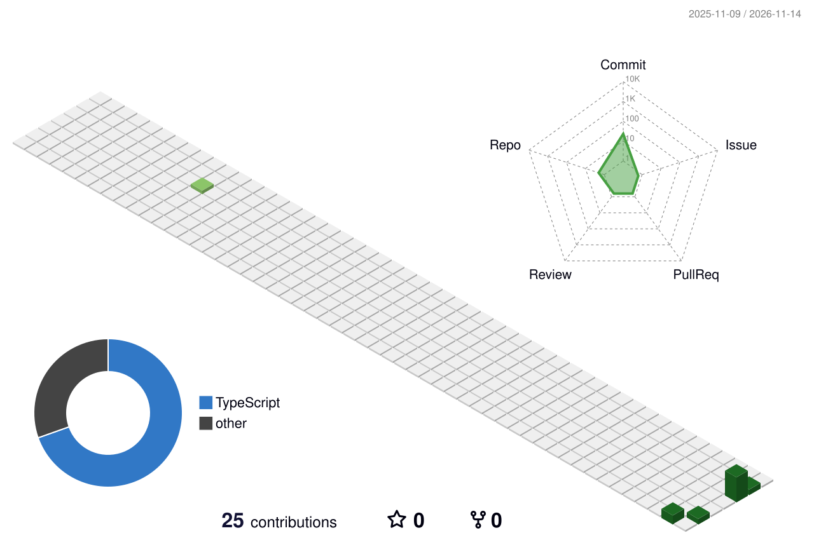

# Hi, I'm Khashayar Ghorab 👋

**PhD Researcher · Applied AI Developer · Construction Safety Technology**

Building and evaluating AI systems that turn visual observations into safer decisions.

## About me

I'm a PhD candidate at the **University of Calgary**, working at the intersection of **generative AI, vision-language models, reinforcement learning, and construction safety**. My research explores how AI systems can recognize hazards, reason about risks, and support human decision-making in real-world environments.

I also build practical tools and prototypes that connect research to applications.

## What I'm working on

- **Vision-language models (VLMs):** grounded hazard identification, localization, and structured safety explanations.
- **Model training and alignment:** supervised fine-tuning (SFT), LoRA/QLoRA, and reinforcement learning using GRPO.
- **Agentic AI:** multi-agent workflows for job safety analysis and risk reasoning.
- **Human–AI decision support:** smart-glasses-based safety assistance and evaluation of usability and trust.

## Tools & technologies

**AI / Research**

**Development**

## GitHub contributions

<!-- Generated by .github/workflows/profile-3d.yml after the first workflow run. -->

  

---

  Research-led AI, built for practical use.

## GitHub Activity

  

